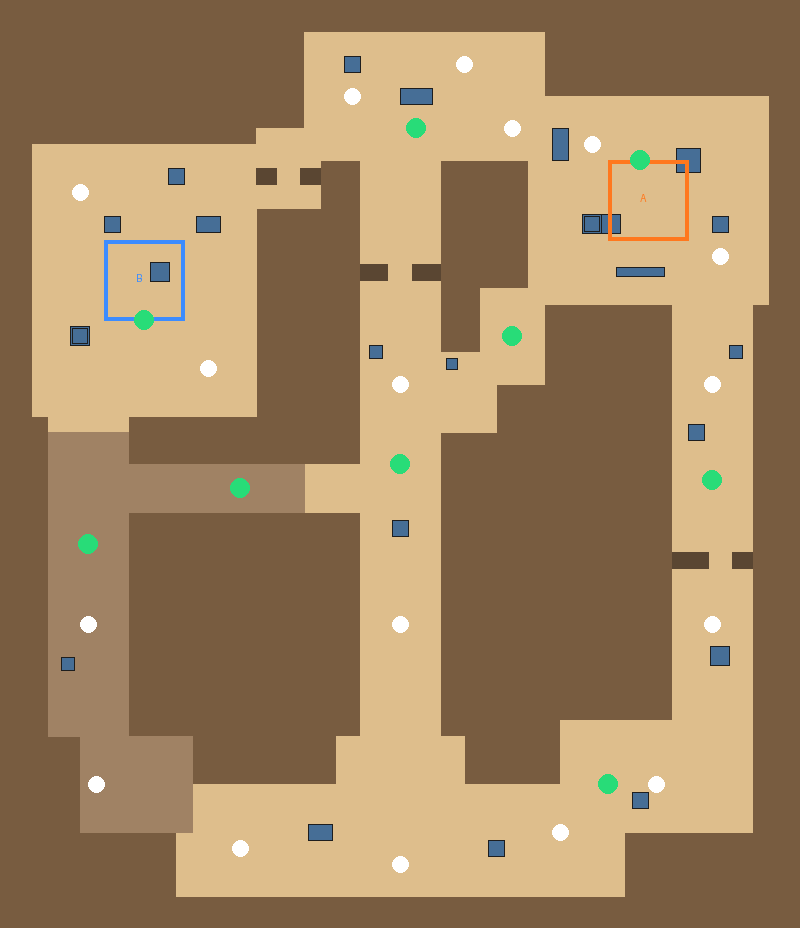
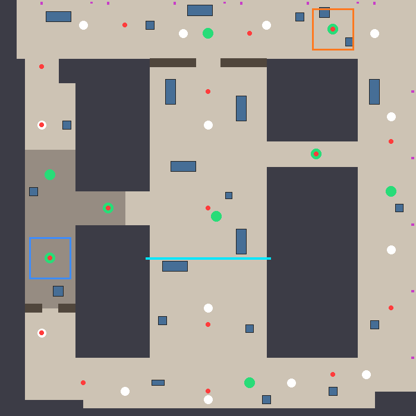
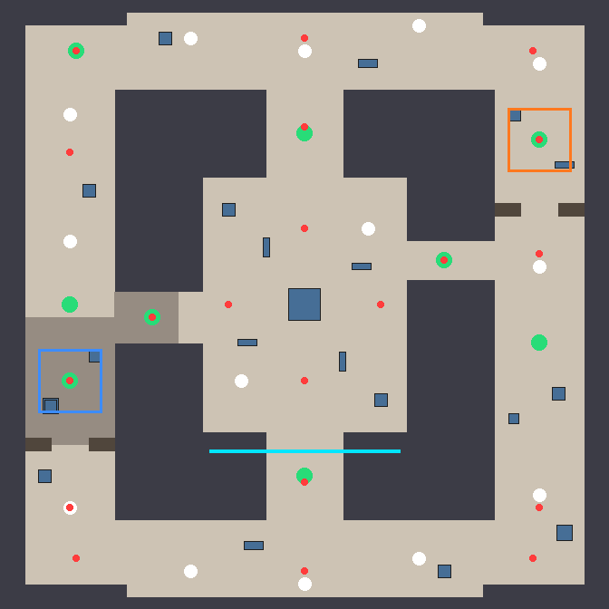

# Dunes Arena

A lightweight browser FPS for the portfolio site: three original arenas, animated characters, powers, power-ups,
AI bots and online matches with friends.

| Dunes | Harbor Night | Frost Outpost |
| --- | --- | --- |
|  |  |  |

- **Dunes** (`map=dunes`): sunny desert with the classic two-site flow (long lane to A, catwalk from mid, tunnels to
  B, mid doors).
- **Harbor Night** (`map=harbor`): a container port at dusk. Stacked containers in the yard, a roofed warehouse lane,
  and an open quay over the water with two gantry cranes.
- **Frost Outpost** (`map=frost`): a snowed-in military base. A courtyard around a command bunker, a hangar lane (B)
  and a trench lane past the comms mast (A).

Every map has a neon **SHREYANSH SHARAN** gantry with an "SS" logo over a main lane, and each match (and the end of
each intermission) opens with a "Shreyansh Sharan presents" title card.

## What's in it

- **Modes:** solo vs 0–9 AI bots (easy / normal / hard), host an online match and share a join code, or join with a code.
  Bots also fill online matches.
- **Powers:** double jump (Space twice), dash (Q or Shift), overshield (E), pulse scan that reveals enemies through
  walls (F), zoom (right click).
- **Power-ups on the map:** health, shield cells, Overdrive (double damage) and Haste (speed).
- **Rules:** free-for-all deathmatch, first to 20 kills or highest score after 8 minutes, then a new round.
  A headshot (the top 0.35 m of the 1.8 m hitbox) kills instantly, shield or not.
- **Look:** stylised tileable textures (`Assets/Arena/Textures`), rigged and animated characters
  (`Assets/Arena/Models`: an operator for players, a combat robot for bots, idle and run), Post Processing Stack v2
  (bloom, ACES grading, vignette, background blur behind menus and a light motion blur while dashing).
- **Still light:** the maps are generated boxes with world-scaled UVs, textures are crunch-compressed at 512 px,
  and sounds are synthesised.

## Set up on a Mac

1. Install **Unity Hub**, then **Unity 6000.0 LTS** (the project pins 6000.0.84f1; any 6000.0.x works) with
   the **WebGL Build Support** module. Apple Silicon is supported natively.
2. In Unity Hub choose **Add → Add project from disk** and pick `unity/ArenaShooter`. The first open downloads the
   packages listed in `Packages/manifest.json`.
3. In the Unity menu bar run **Arena → 1. Generate Scene and Prefabs**. This imports the textures and character
   models, creates the materials, the player, bot and pickup prefabs, all three maps (side by side, 400 m apart),
   one NavMesh covering them, the post-processing profiles and `Assets/Arena/Scenes/Arena.unity`.
   **Re-run it after pulling changes** to the maps, models or this setup code; the scene is never edited by hand.
4. Open that scene and press **Play**. Pick a map, then **Play vs bots** to try it immediately.

The packages it needs (Netcode, Multiplayer Services, AI Navigation, glTFast for the `.glb` characters, Post
Processing) are all in `Packages/manifest.json`.

### Online play (optional)

Online matches use Unity Multiplayer Services (sessions over Relay, secure WebSockets so browsers can join).

1. **Edit → Project Settings → Services**: link the project to a Unity Cloud project (free).
2. In the Unity Cloud dashboard enable **Relay** and **Lobby** for that project.
3. **Host online match** shows an invite code; friends enter it under **Join**, or open the site's invite link.

Solo mode works without any of this.

## Build into the portfolio site

Run **Arena → 2. Build WebGL into Portfolio Site**. It writes the build to `site/public/games/arena/`, which the
site's Arena page loads in an iframe. Commit that folder and push; the site's GitHub Pages workflow publishes it.

From the command line (Unity must be activated):

```bash
/Applications/Unity/Hub/Editor/6000.0.84f1/Unity.app/Contents/MacOS/Unity \
  -batchmode -quit -projectPath unity/ArenaShooter \
  -executeMethod Arena.EditorTools.ArenaSetup.GenerateAndBuild
```

The build uses Gzip with decompression fallback (works on GitHub Pages), Medium code stripping and a minimal custom
loading page (`Assets/WebGLTemplates/Arena`).

## How the page talks to the game

The site starts the game with URL parameters, for example
`games/arena/index.html?mode=solo&bots=5&diff=1&name=Ana&map=harbor` or `?mode=join&code=ABC123`.

| Parameter | Values |
| --- | --- |
| `mode` | `solo`, `host`, `join` (anything else shows the in-game menu) |
| `bots` | 0–9 |
| `diff` | 0 easy, 1 normal, 2 hard |
| `name` | player name (16 characters max) |
| `code` | join code, for `mode=join` |
| `map` | `dunes` (default), `harbor` or `frost`. The host's map wins: people who join play whatever the host picked |

The game reports back with `postMessage({ source: 'arena', type, payload })`, where type is `ready`, `started`,
`code` (the join code to share), `map` (the map id once a match runs), `error` or `left`.

## Controls

WASD move · mouse aim · left click fire · right click zoom · Space jump (twice to double jump) · Q or Shift dash ·
E overshield · F pulse scan · R reload · Tab scoreboard.

## Code map

| Path | What it does |
| --- | --- |
| `Scripts/Map/MapDefinition.cs`, `Maps.cs` | Generic map data (walkable areas, blockers, roofs, props, decor, spawns, pickups, waypoints, sites, brand gantry, lighting, textures) and the list of maps |
| `Scripts/Map/DunesMap.cs`, `HarborMap.cs`, `FrostMap.cs` | The three maps as data |
| `Scripts/Map/MapBuilder.cs`, `BoxMesh.cs` | Turns a map into textured boxes (world-scaled UVs), neon trims, site plates and the branded gantry |
| `Scripts/Map/MapRuntime.cs` | Enables the active map and applies its fog, ambient light, sky and sun |
| `Scripts/Game/CharacterAnimator.cs` | Crossfades idle/run on the character models from their movement speed |
| `Scripts/Fx/PostFx.cs` | Post-processing layers and the menu/dash blur volumes |
| `Scripts/Core/ArenaBootstrap.cs` | Reads launch options and starts solo, host or join |
| `Scripts/Core/SessionService.cs` | Multiplayer Services sessions (Relay, join codes) |
| `Scripts/Game/Combatant.cs` | Health, shield, score, buffs and respawn, shared by players and bots (server-owned) |
| `Scripts/Game/PlayerController.cs` | First-person movement and powers (owner-authoritative for instant feel) |
| `Scripts/Game/Weapon.cs` | Hitscan pulse rifle: client-detected hits, server-applied damage |
| `Scripts/Game/BotBrain.cs` | AI: roam, spot, strafe, shoot with skill-based aim, grab health, use overshield |
| `Scripts/Game/Pickup.cs`, `MatchManager.cs` | Power-ups, deathmatch rules, kill feed |
| `Scripts/UI/ArenaHud.cs` | Menu and HUD (IMGUI, no UI assets) |
| `Scripts/Fx/*` | Pooled effects and synthesised sounds |
| `Editor/ArenaSetup.cs` | Generates everything and builds WebGL |

Adding a map: copy one of the map files, give it a new `Id` and an `Origin` 400 m past the last one, add it to
`Maps.All`, then re-run Arena → 1. Keep every spawn, pickup and waypoint inside a walkable rect and clear of props.

Tuning lives in public fields and constants: weapon damage and fire rate in `Weapon`, movement and cooldowns in
`PlayerController`, bot skill levels in `BotBrain.Skills`, kill limit and match length in `MatchManager`.

## Credits

Textures (21 stylised tileable sets) were generated with Higgsfield (GPT Image 2.5) and the two characters with
Meshy 6 text-to-3D plus Meshy rigging via Higgsfield, for about 71 credits in total. The GLBs keep only a tiny
placeholder texture; the albedo maps sit next to them as JPGs so Unity can compress them.
