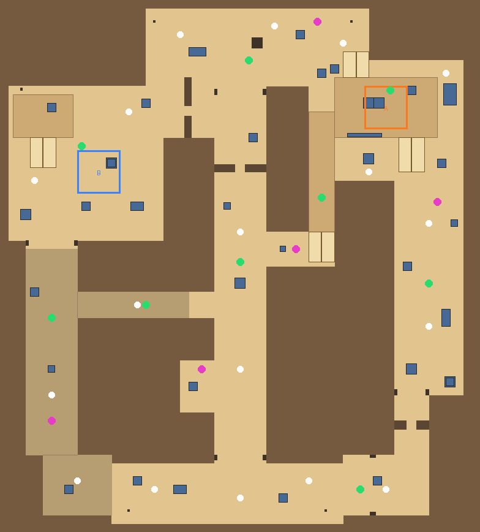
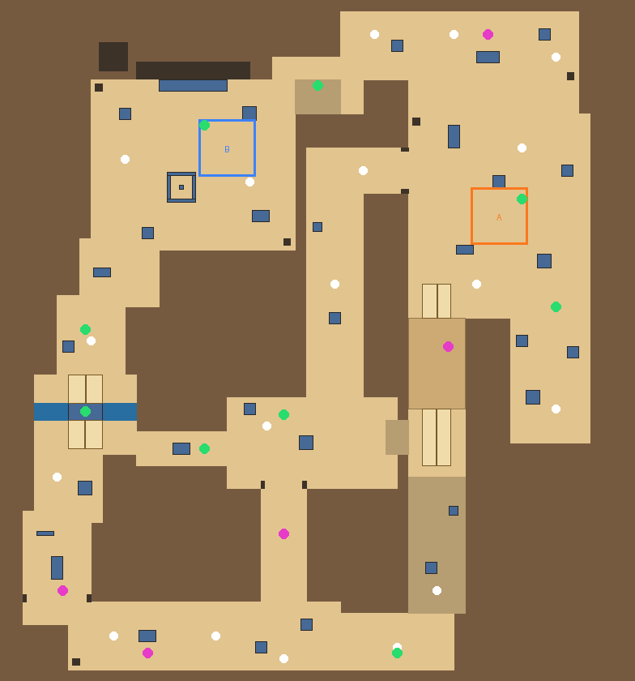
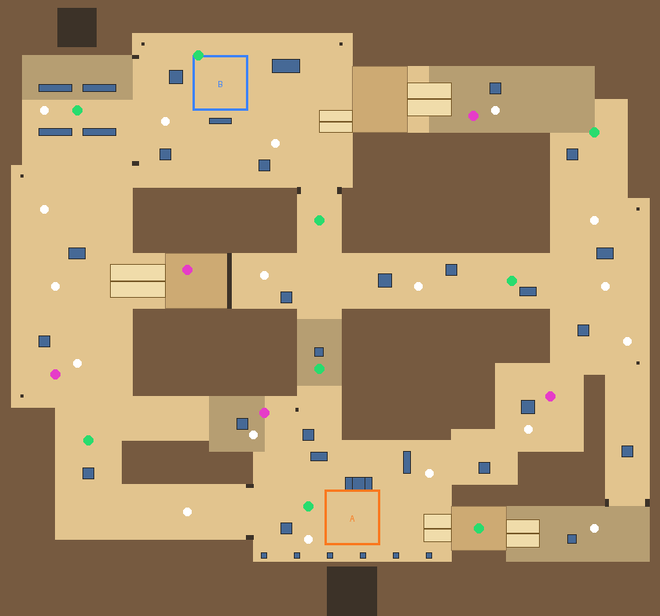

# Dunes Arena

A lightweight browser FPS for the portfolio site: six original arenas, five weapons with aim-down-sights and a
scoped sniper, animated characters, powers, power-ups, AI bots and online matches with friends.

| Dunes | Harbor Night | Frost Outpost |
| --- | --- | --- |
|  |  |  |

| Sandstorm | Villa | Bazaar |
| --- | --- | --- |
|  |  |  |

Layouts from above (north up): white dots are spawns, green power-ups, magenta weapon crates, pale boxes raised
floors, striped ramps, blue water.

- **Dunes** (`map=dunes`): sunny desert with the classic two-site flow (long lane to A, catwalk from mid, tunnels to
  B, mid doors).
- **Harbor Night** (`map=harbor`): a container port at dusk. Stacked containers in the yard, a roofed warehouse lane,
  and an open quay over the water with two gantry cranes.
- **Frost Outpost** (`map=frost`): a snowed-in military base. A courtyard around a command bunker, a hangar lane (B)
  and a trench lane past the comms mast (A).

The next three are homages to the shooter community's classic map archetypes: recognisable flows, original layouts,
names and textures.

- **Sandstorm** (`map=sandstorm`): a sun-bleached sandstone town. Long A runs up the east side through a double door
  to an A site raised on a plinth; a long mid lane with a double door splits the map; a raised catwalk climbs from mid
  to A; roofed tunnels run under the west side to B, which has a raised back platform. Arches, parapets, palms.
- **Villa** (`map=villa`): an Italian hillside village with terracotta tile roofs, shuttered windows, balconies and
  washing lines. A long curved lane (the "banana") climbs from the attackers over a stone bridge across a canal to B,
  a church courtyard with a fountain and a bell tower; narrow alleys lead through mid to an arch; an apartment block
  with a balcony overlooks A, a farm square with a pit.
- **Bazaar** (`map=bazaar`): a market town at dusk with domes, lanterns and lit windows. A sits in a colonnaded square
  under the palace (through the palace hall and its balcony, or down the ramp); B is a market square reached through an
  apartment block (with an upper floor overlooking B) or the covered market stalls; a long mid is watched by a sniper
  window on the defenders' side, and a connector and a planted "jungle" link mid to A.

Every map has a neon **SHREYANSH SHARAN** gantry with an "SS" logo over a main lane, and each match (and the end of
each intermission) opens with a "Shreyansh Sharan presents" title card.

## What's in it

- **Modes:** solo vs 0–9 AI bots (easy / normal / hard), host an online match and share a join code, or join with a code.
  Bots also fill online matches.
- **Weapons** (keys 1–5 or the mouse wheel). Everyone carries the sidearm plus a primary picked on the site, in the
  menu, while dead (keys 2–5) or on the pause screen; weapon crates on the maps add more until you die.

  | Key | Weapon | Damage (head x) | Fire | Magazine / reload | Range falloff | Move | Notes |
  | --- | --- | --- | --- | --- | --- | --- | --- |
  | 1 | P9 Sidearm (pistol) | 24 (x3) | semi, 0.16 s | 12 / 1.1 s | 100% to 15 m, 60% at 45 m | 105% | always carried |
  | 2 | Vespa SMG | 14 (x2) | auto, ~920 rpm | 32 / 1.6 s | 100% to 10 m, 45% at 35 m | 108% | accurate on the move |
  | 3 | Kestrel AR (assault rifle) | 22 (x2.5) | auto, 600 rpm | 30 / 1.9 s | 100% to 35 m, 75% at 90 m | 95% | learnable climb-then-sway spray pattern |
  | 4 | Longbow (bolt-action sniper) | 100 (x2.5) | bolt, 1.35 s | 5 / 2.6 s | none to 200 m | 85% | 2-level scope; 7° off when unscoped |
  | 5 | Mastiff (pump shotgun) | 9 x 11 (x1.5) | pump, 0.85 s | 6 / 2.4 s | 100% to 6 m, 20% at 22 m | 97% | 4.5° pellet cone |

  Each has its own synthesised sound, muzzle flash size, tracer width and colour, view model and recoil.
  Headshots (the top 0.35 m of the 1.8 m hitbox) multiply damage; a sniper headshot always kills (250 > 100 health
  + 100 shield), a sniper body shot kills an unshielded player.
- **Aiming:** hold right click to aim down sights: the view zooms (per weapon), sensitivity scales with the field of
  view, spread tightens, you move slower and the crosshair becomes a dot with brackets. The sniper's right click steps
  through two scope zooms (about x3 and x7.7) and back out; the wheel zooms while scoped and switches weapons otherwise.
  The scope draws a lens overlay with a mil-dot reticle. The crosshair always shows the real cone of fire.
- **Powers:** double jump (Space twice), dash (Q or Shift), overshield (E), pulse scan that reveals enemies through
  walls and on the minimap (F).
- **Power-ups on the map:** health, shield cells, Overdrive (double damage), Haste (speed) and weapon crates.
- **Bots** take weapon roles: snipers walk to perches and hold long angles (and pull the pistol up close), shotguns
  push in and hunt, rifles and SMGs keep their range band. Some riflemen hold angles too.
- **Rules:** free-for-all deathmatch, first to 20 kills or highest score after 8 minutes, then a new round.
- **Look:** stylised tileable textures (`Assets/Arena/Textures`), rigged and animated characters
  (`Assets/Arena/Models`: an operator for players, a combat robot for bots, idle and run), Post Processing Stack v2
  (bloom, ACES grading, vignette, background blur behind menus and a light motion blur while dashing).
- **Still light:** the maps are generated boxes with world-scaled UVs, textures are crunch-compressed at 512 px,
  and sounds are synthesised.

## Set up on a Mac

1. Install **Unity Hub**, then **Unity 6000.0 LTS** (the project pins 6000.0.84f1; any 6000.0.x works) with
   the **WebGL Build Support** module. Apple Silicon is supported natively.
2. In Unity Hub choose **Add → Add project from disk** and pick `unity/ArenaShooter`. The first open downloads the
   packages listed in `Packages/manifest.json`.
3. In the Unity menu bar run **Arena → 1. Generate Scene and Prefabs**. This imports the textures and character
   models, creates the materials, the player, bot and pickup prefabs, all six maps (side by side, 400 m apart),
   one NavMesh covering them, the post-processing profiles and `Assets/Arena/Scenes/Arena.unity`.
   **Re-run it after pulling changes** to the maps, models or this setup code; the scene is never edited by hand.
4. Open that scene and press **Play**. Pick a map, then **Play vs bots** to try it immediately.

The packages it needs (Netcode, Multiplayer Services, AI Navigation, glTFast for the `.glb` characters, Post
Processing) are all in `Packages/manifest.json`.

### Online play (optional)

Online matches use Unity Multiplayer Services (sessions over Relay, secure WebSockets so browsers can join).

1. **Edit → Project Settings → Services**: link the project to a Unity Cloud project (free).
2. In the Unity Cloud dashboard enable **Relay** and **Lobby** for that project.
3. **Host online match** shows an invite code; friends enter it under **Join**, or open the site's invite link.

Solo mode works without any of this.

## Build into the portfolio site

Run **Arena → 2. Build WebGL into Portfolio Site**. It writes the build to `site/public/games/arena/`, which the
site's Arena page loads in an iframe. Commit that folder and push; the site's GitHub Pages workflow publishes it.

From the command line (Unity must be activated):

```bash
/Applications/Unity/Hub/Editor/6000.0.84f1/Unity.app/Contents/MacOS/Unity \
  -batchmode -quit -projectPath unity/ArenaShooter \
  -executeMethod Arena.EditorTools.ArenaSetup.GenerateAndBuild
```

The build uses Gzip with decompression fallback (works on GitHub Pages), Medium code stripping and a minimal custom
loading page (`Assets/WebGLTemplates/Arena`).

## How the page talks to the game

The site starts the game with URL parameters, for example
`games/arena/index.html?mode=solo&bots=5&diff=1&name=Ana&map=harbor` or `?mode=join&code=ABC123`.

| Parameter | Values |
| --- | --- |
| `mode` | `solo`, `host`, `join` (anything else shows the in-game menu) |
| `bots` | 0–9 |
| `diff` | 0 easy, 1 normal, 2 hard |
| `name` | player name (16 characters max) |
| `code` | join code, for `mode=join` |
| `map` | `dunes` (default), `harbor`, `frost`, `sandstorm`, `villa` or `bazaar`. The host's map wins: people who join play whatever the host picked |
| `gun` | primary to spawn with: `smg`, `rifle` (default), `sniper` or `shotgun` |

The game reports back with `postMessage({ source: 'arena', type, payload })`, where type is `ready`, `started`,
`code` (the join code to share), `map` (the map id once a match runs), `error` or `left`.

## Controls

WASD move · mouse aim · left click fire · hold right click to aim down sights (sniper: right click steps the scope,
wheel zooms while scoped) · 1–5 or mouse wheel switch weapons · R reload · Space jump (twice to double jump) · Q or
Shift dash · E overshield · F pulse scan · Tab scoreboard. While dead, 2–5 pick the primary for the next spawn.

## Code map

| Path | What it does |
| --- | --- |
| `Scripts/Map/MapDefinition.cs`, `Maps.cs` | Generic map data (walkable areas, blockers, roofs, props, decor, spawns, pickups, waypoints, sites, brand gantry, lighting, textures) and the list of maps |
| `Scripts/Map/DunesMap.cs`, `HarborMap.cs`, `FrostMap.cs`, `SandstormMap.cs`, `VillaMap.cs`, `BazaarMap.cs` | The six maps as data |
| `Scripts/Map/MapBuilder.cs`, `BoxMesh.cs` | Turns a map into textured boxes and wedges (world-scaled UVs): buildings with flat, parapet or tiled gable roofs, windows, domes, ramps, water, neon trims, site plates and the branded gantry |
| `Scripts/Map/MapRuntime.cs` | Enables the active map and applies its fog, ambient light, sky and sun |
| `Scripts/Game/CharacterAnimator.cs` | Crossfades idle/run on the character models from their movement speed |
| `Scripts/Fx/PostFx.cs` | Post-processing layers and the menu/dash blur volumes |
| `Scripts/Core/ArenaBootstrap.cs` | Reads launch options and starts solo, host or join |
| `Scripts/Core/SessionService.cs` | Multiplayer Services sessions (Relay, join codes) |
| `Scripts/Game/Combatant.cs` | Health, shield, score, buffs and respawn, shared by players and bots (server-owned) |
| `Scripts/Game/PlayerController.cs` | First-person movement and powers (owner-authoritative for instant feel) |
| `Scripts/Game/WeaponSpec.cs` | The five weapons as data: damage, falloff, fire rate, magazine, spread, recoil pattern, zoom, sound, bot ranges |
| `Scripts/Game/Weapon.cs` | The arsenal: switching, loadout, crates, hitscan with pellets; client-detected hits, server-applied damage |
| `Scripts/Game/BotBrain.cs` | AI: weapon roles, roam, hold angles from perches, spot, strafe or push by range, shoot with skill-based aim, grab health, use overshield |
| `Scripts/Game/Pickup.cs`, `MatchManager.cs` | Power-ups, deathmatch rules, kill feed |
| `Scripts/UI/ArenaHud.cs` | Menu and HUD (IMGUI, no UI assets): crosshairs, scope overlay, weapon slots, minimap, kill feed |
| `Scripts/Fx/*` | Pooled effects and synthesised sounds |
| `Editor/ArenaSetup.cs` | Generates everything and builds WebGL |
| `Tools/make_textures.py` | Regenerates the procedural textures of the three newer maps (numpy + Pillow) |

Adding a map: copy one of the map files, give it a new `Id` and an `Origin` 400 m past the last one, add it to
`Maps.All`, then re-run Arena → 1. Keep every spawn, pickup and waypoint inside a walkable rect and clear of props.
Raised floors are big `Prop`s reached by `Ramps` (keep slopes under 30°), `Water` rects are impassable but shootable
over, and `Perches` are where sniper bots hold angles. Add the new id to the map selector in `site/src/components/Arena.tsx`.

Tuning lives in data and constants: every weapon in `WeaponSpec.All`, movement and cooldowns in `PlayerController`,
bot skill levels in `BotBrain.Skills`, kill limit and match length in `MatchManager`.

## Credits

The textures of the first three maps (21 stylised tileable sets) and the two rigged characters were AI-generated.
The GLBs keep only a tiny placeholder texture; the albedo maps sit next to them as JPGs so Unity can compress them.
The Sandstorm, Villa and Bazaar textures (sandstone blocks, roof tiles, cobbles, stucco, adobe, awning stripes) are
procedural: `python3 Tools/make_textures.py` regenerates them. No textures, models or names come from other games.

See [REBUILD.md](REBUILD.md) for rebuilding the WebGL build into the site after changes.
